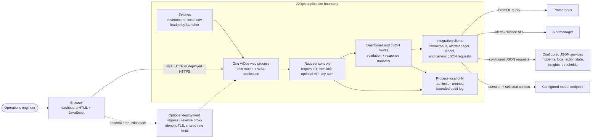
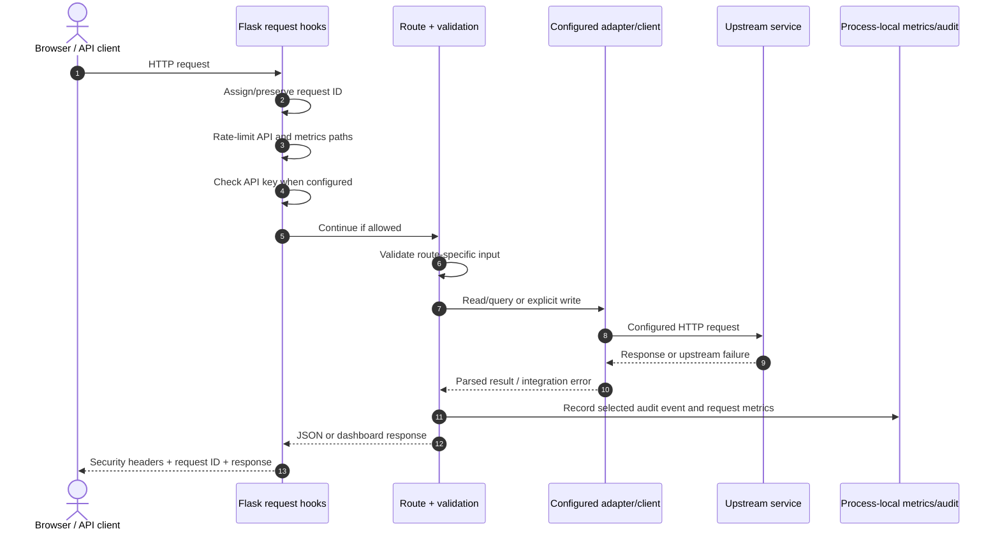
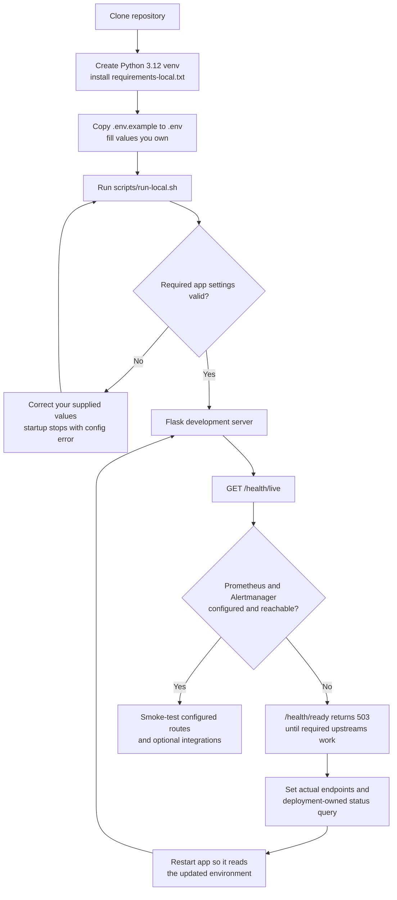

# AiOps Architecture and Data Flow

This document describes the **current code path** and separates it from recommendations that still need implementation. The system view uses C4-style boundaries: the application container and its direct dependencies are shown here, while environment-specific deployment topology is kept separate because gateways, replicas, and failover vary by deployment. [1]

## 1. System boundary

AiOps is a single Flask web application that serves a small browser dashboard and JSON API. It reads operational data from configured upstream systems and can send limited, explicit writes to Alertmanager or a configured threshold endpoint. Prometheus, Alertmanager, incident/log/insight/action-state services, and the model endpoint remain the sources of truth. AiOps does not create sample operational records or persist upstream data locally.

The dotted ingress path is a deployment option, not an application component. Flask documents its built-in server as development-only and recommends a production WSGI server or hosting platform for deployments. [3] The diagram does not imply that upstream systems, a database, an identity provider, or a durable telemetry backend are included in this repository.

## 2. Request flow

`web_dashboard.py` is the composition root: it loads `Settings`, builds the Flask app, creates the adapters and in-process registries, and registers routes. `Settings.from_env()` and app construction currently run at module import time. As the test matrix grows, move composition into a `create_app(settings)` factory and pass dependencies explicitly; Flask documents the factory pattern as a way to create app instances with different settings for testing. [9]

Request processing is currently:

The API-key check applies to `/api/*` and `/metrics` when `AIOPS_API_KEY` is set. Production configuration requires an API key of at least 24 characters; outside production, omitting the key leaves those routes unauthenticated. The dashboard JavaScript does not send an API key. Therefore, when API-key authentication is enabled, browser API calls need a deliberately configured same-origin session/proxy that authenticates the browser request, or the dashboard calls will receive `401`. Do not put a shared API key in browser JavaScript. CORS allowlisting alone does not provide authentication or authorization.

### Read and analysis paths

- `/health/live` reports that the process can answer HTTP; it does not probe dependencies.
- `/health/ready` requires Prometheus configuration/status query and Alertmanager configuration, then checks those upstreams. It does not prove that optional incident, log, insight, threshold, action-state, or model endpoints work.
- `/api/status` queries the configured status expression and reads alert/incident counts when those sources are configured. `/api/query` validates a user question, assembles the configured metric/alert/incident context, calls the configured model, and records a query fingerprint rather than the raw query in the legacy audit log.
- Other read routes call their configured source. Missing optional sources are not replaced with generated or sample data.

### Explicit write paths

`POST /api/suppress-alert` checks that the alert is active before requesting an Alertmanager silence. `POST /api/set-thresholds` validates exactly the `cpu`, `mem`, and `disk` values before forwarding them to the configured threshold service. AiOps does not persist threshold values itself. The dashboard has read-only action/remediation-state routes; there is no general action-execution route in the Flask control path.

These routes are not a complete approval system. A request comment or an API key does not prove a human approval decision. Put identity, role/scope checks, approval records, and an auditable change process at a trusted gateway or a separately designed policy service before exposing writes to multiple operators.

## 3. Local developer flow

The local path is intentionally explicit and does not invent service URLs, credentials, model IDs, or operational limits:

1. Create a Python 3.12 virtual environment and install `requirements-local.txt` (or follow [QUICK_START.md](QUICK_START.md)).
2. Copy `.env.example` to `.env` and fill the required values from your own environment. Blank values are placeholders, not defaults. The launcher loads `.env`; importing `web_dashboard.py` directly does not load it.
3. Run `./scripts/run-local.sh`. This starts Flask's development server for local testing only.
4. Check `/health/live` to confirm the process started. Expect `/health/ready` to return `503` until the real Prometheus and Alertmanager endpoints and status query are supplied and reachable.
5. Add optional upstream integrations only when you have their actual endpoint contracts and authorization method. Run deployment-level integration tests against those systems before relying on their routes.

For production, run `web_dashboard:app` through an approved WSGI server and deployment process. Provide deploy-specific values through the environment or a secrets platform rather than source constants; this follows the Twelve-Factor configuration principle. [2] Terminate TLS and apply organization identity, authorization, network policy, browser-session handling, and shared rate limits at a reviewed ingress/gateway. [3]

## 4. Runtime state and telemetry: current limits

The following behavior is in-process and is lost on restart. It is not shared between workers or replicas:

- The sliding-window rate limiter uses the direct peer address. It is not a cluster-wide control.
- `MetricsRegistry` tracks request counts and a bounded duration sample window. `/metrics` exports request counters and duration sum/count; it does not currently export a latency histogram, distributed trace, or `/api/slo` values.
- `/api/slo` computes availability from retained requests in this process. Current error counting treats HTTP status codes `>=500` as errors, so 4xx and 429 responses count as available. This snapshot is not a durable or cluster-wide SLO measurement.
- The web app's legacy `AuditLog` is bounded and records selected events, not every request or every failure. The separate typed `AuditEvent`/`AuditSink` contract exists, but no durable sink is wired to the web routes.
- `BoundedStore` is currently written by dashboard refresh helpers but not read by the API routes. It is not a response cache or persistent data store.

OpenTelemetry groups telemetry into traces, metrics, and logs; these signals help investigate service behavior from different angles. [4] Google SRE recommends monitoring latency, traffic, errors, and saturation, and designing SLIs around what users experience. [5] [6] The current implementation provides only a subset, so do not use its local `/api/slo` snapshot alone for paging, contractual reporting, or compliance evidence.

## 5. Trust boundaries and known integration gaps

Configuration values and response data belong to the deploying organization. The app must not infer a missing endpoint or trust an upstream payload merely because it is valid JSON.

- The typed Prometheus, Alertmanager, and model clients apply configured timeout/TLS settings. The HTTP clients do not currently expose a general per-upstream credential configuration for Prometheus, Alertmanager, or the generic JSON endpoints; protect these connections at the network boundary or add explicit client-auth support before connecting to protected services.
- Generic incident/log/action/insight/threshold requests are not a uniform, schema-versioned adapter contract. Response validation is endpoint-specific and less complete than a production integration contract should be. Add response schemas and contract tests for each real upstream before deployment.
- Browser CORS support is an origin allowlist header, not a complete cross-origin preflight/authentication solution. Prefer same-origin serving or a reviewed gateway/session design for the UI.
- The model receives the user question and selected operational context. Prompt injection cannot be eliminated by prompt wording alone. OWASP recommends constrained model behavior, deterministic output validation, least privilege, separation of untrusted content, adversarial testing, and human approval for high-risk actions. [7] NIST's Generative AI Profile is a voluntary companion for managing AI trustworthiness considerations across design, development, use, and evaluation. [8]
- The model has no local shell or general action tool in this Flask route path. Keep that boundary explicit; do not connect model output directly to an executor.

## 6. Engineering sequence for a production-ready deployment

These are recommendations, not claims about existing code. They are ordered to make the next engineering step clear without adding a guessed enterprise stack:

1. **Make app construction testable.** Move import-time settings/app creation into a factory with explicit settings and dependencies. Test multiple configurations without relying on process-global environment mutation. [9]
2. **Define deployment ownership.** Select the actual WSGI server, ingress, TLS, identity/session method, secret injector, and network policy for the target environment. Keep local development independent of those choices.
3. **Close the authorization gap.** Decide whether the browser UI uses a same-origin authenticated session or is disabled when API-key protection is active. Add role/scope authorization for write routes and a verified human-approval record before expanding access.
4. **Harden each integration contract.** For every configured endpoint, document authentication, timeout, TLS, request/response schema, retry/idempotency behavior, and failure mapping. Add mock-based contract tests and deployment smoke tests; never substitute fabricated data.
5. **Make reliability data meaningful at scale.** Define user-facing SLIs with explicit good-event/total-event semantics and a time window. Add histogram/percentile telemetry and shared/durable aggregation before using SLOs for paging or release gates. Google SRE recommends starting from critical user interactions and iterating measured SLOs rather than guessing targets. [6]
6. **Make controls shared and durable where needed.** Replace or front the per-process limiter, metrics aggregation, and selected-event audit log with deployment-owned shared services if running multiple workers/replicas or retaining evidence. Test restart and multi-worker behavior.
7. **Threat-model the model boundary.** Classify which operational fields may be sent to the configured model, test direct and indirect prompt injection, validate output before display/use, and keep all privileged actions behind deterministic policy and human approval. [7] [8]

## References

[1]: https://c4model.com/diagrams/container "C4 Model Container Diagram"
[2]: https://12factor.net/config "The Twelve-Factor App: Config"
[3]: https://flask.palletsprojects.com/en/stable/deploying/ "Flask: Deploying to Production"
[4]: https://opentelemetry.io/docs/concepts/observability-primer/ "OpenTelemetry Observability Primer"
[5]: https://sre.google/sre-book/monitoring-distributed-systems/ "Google SRE Book: Monitoring Distributed Systems"
[6]: https://sre.google/workbook/implementing-slos/ "Google SRE Workbook: Implementing SLOs"
[7]: https://genai.owasp.org/llmrisk/llm01-prompt-injection/ "OWASP LLM01:2025 Prompt Injection"
[8]: https://www.nist.gov/publications/artificial-intelligence-risk-management-framework-generative-artificial-intelligence "NIST AI RMF Generative AI Profile"
[9]: https://flask.palletsprojects.com/en/stable/patterns/appfactories/ "Flask Application Factories"
