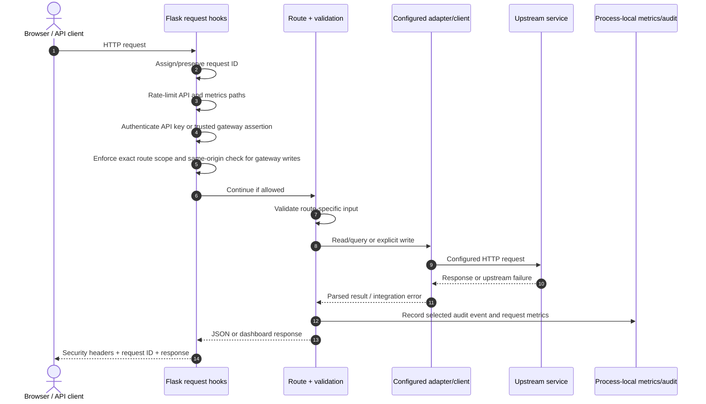
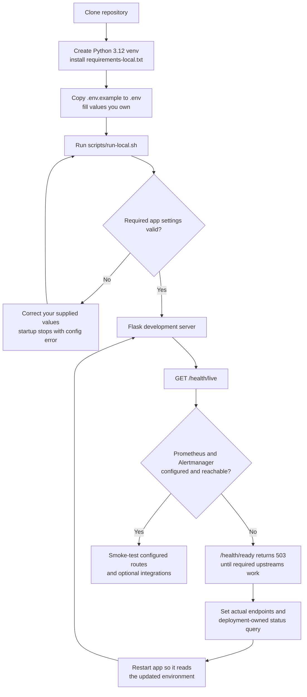

# AiOps Architecture and Data Flow

This document describes the **current code path** and separates it from recommendations that still need implementation. The system view uses C4-style boundaries: the application container and its direct dependencies are shown here, while environment-specific deployment topology is kept separate because gateways, replicas, and failover vary by deployment. [1]

## 1. System boundary

AiOps is a single Flask web application that serves a small browser dashboard and JSON API. It reads operational data from configured upstream systems and can send limited, explicit writes to Alertmanager or a configured threshold endpoint. Prometheus, Alertmanager, incident/log/insight/action-state services, and the model endpoint remain the sources of truth. AiOps does not create sample operational records or persist upstream data locally.

The dotted ingress path is a deployment option, not an application component. Flask documents its built-in server as development-only and recommends a production WSGI server or hosting platform for deployments. [3] The diagram does not imply that upstream systems, a database, an identity provider, or a durable telemetry backend are included in this repository.

## 2. Request flow

`web_dashboard.py` is the composition root. `create_app(settings, dependencies=...)` builds an independently configured Flask application, adapters, and in-process registries; tests can pass explicit settings and fake upstream clients without changing process-wide environment variables. The production `web_dashboard:app` WSGI callable remains available and loads deployment settings when first used, while importing the module itself does not require deployment configuration. Flask documents the factory pattern as a way to create app instances with different settings for testing. [9]

Request processing is currently:

`/api/*` and `/metrics` require credentials when an API key or gateway token is configured, and production still requires an API key of at least 24 characters. An API key grants only `aiops:read`. A trusted same-origin gateway may authenticate the browser session and forward a server-side `AIOPS_GATEWAY_TOKEN`, principal, and explicit scope claims; the gateway must overwrite these headers and keep its token out of browser code. Only exact route scopes authorize the two write endpoints. Gateway-authenticated unsafe methods also require an `Origin` matching `AIOPS_ALLOWED_ORIGINS` as CSRF protection. The dashboard explicitly uses same-origin cookies and never sends a shared service key. CORS allowlisting alone does not provide authentication or authorization.

### Read and analysis paths

- `/health/live` reports that the process can answer HTTP; it does not probe dependencies.
- `/health/ready` requires Prometheus configuration/status query and Alertmanager configuration, then checks those upstreams. It does not prove that optional incident, log, insight, threshold, action-state, or model endpoints work.
- `/api/status` queries the configured status expression and reads alert/incident counts when those sources are configured. `/api/query` validates a user question, assembles the configured metric/alert/incident context, calls the configured model, and records a query fingerprint rather than the raw query in the legacy audit log.
- Other read routes call their configured source. Missing optional sources are not replaced with generated or sample data.

### Explicit write paths

`POST /api/suppress-alert` requires `aiops:alerts:silence`, checks that the alert is active, and records the authenticated principal as the Alertmanager actor and audit subject. `POST /api/set-thresholds` requires `aiops:thresholds:write`, validates exactly the `cpu`, `mem`, and `disk` values, and records the principal before forwarding to the configured threshold service. AiOps does not persist threshold values itself. The dashboard has read-only action/remediation-state routes; there is no general action-execution route in the Flask control path.

Scopes authorize only the narrow route action; they do not prove a separate human approval decision. Put identity verification, approval records, and an auditable change process at the trusted gateway or a separately designed policy service before exposing writes to multiple operators. `/health/live` and `/health/ready` remain public liveness/readiness endpoints.

## 3. Local developer flow

The local path is intentionally explicit and does not invent service URLs, credentials, model IDs, or operational limits:

1. Create a Python 3.12 virtual environment and install `requirements-local.txt` (or follow [QUICK_START.md](QUICK_START.md)).
2. Copy `.env.example` to `.env` and fill the required values from your own environment. Blank values are placeholders, not defaults. The launcher loads `.env`; importing `web_dashboard.py` directly does not load it.
3. Run `./scripts/run-local.sh`. This starts Flask's development server for local testing only.
4. Check `/health/live` to confirm the process started. Expect `/health/ready` to return `503` until the real Prometheus and Alertmanager endpoints and status query are supplied and reachable.
5. Add optional upstream integrations only when you have their actual endpoint contracts and authorization method. Run deployment-level integration tests against those systems before relying on their routes.

For production, run `web_dashboard:app` through an approved WSGI server and deployment process. Provide deploy-specific values through the environment or a secrets platform rather than source constants; this follows the Twelve-Factor configuration principle. [2] Terminate TLS and apply organization identity, authorization, network policy, browser-session handling, and shared rate limits at a reviewed ingress/gateway. [3]

## 4. Runtime state and telemetry: current limits

The following behavior is in-process and is lost on restart. It is not shared between workers or replicas:

- The sliding-window rate limiter uses the direct peer address. It is not a cluster-wide control.
- `MetricsRegistry` tracks request counts and a bounded duration sample window. `/metrics` exports request counters and duration sum/count; it does not currently export a latency histogram, distributed trace, or `/api/slo` values.
- `/api/slo` computes availability from retained requests in this process. Current error counting treats HTTP status codes `>=500` as errors, so 4xx and 429 responses count as available. This snapshot is not a durable or cluster-wide SLO measurement.
- The web app's legacy `AuditLog` is bounded and records selected events, not every request or every failure. The separate typed `AuditEvent`/`AuditSink` contract exists, but no durable sink is wired to the web routes.
- `BoundedStore` is currently written by dashboard refresh helpers but not read by the API routes. It is not a response cache or persistent data store.

OpenTelemetry groups telemetry into traces, metrics, and logs; these signals help investigate service behavior from different angles. [4] Google SRE recommends monitoring latency, traffic, errors, and saturation, and designing SLIs around what users experience. [5] [6] The current implementation provides only a subset, so do not use its local `/api/slo` snapshot alone for paging, contractual reporting, or compliance evidence.

## 5. Trust boundaries and known integration gaps

Configuration values and response data belong to the deploying organization. The app must not infer a missing endpoint or trust an upstream payload merely because it is valid JSON.

- Operational upstreams support independent optional `none`, Bearer, or Basic authentication, source-specific timeout/TLS overrides, and strict app-side response contracts. Credentials are injected through environment/secret management, never placed in endpoint URLs, and sanitized from settings representations and error responses.
- Prometheus and Alertmanager are validated against their consumed response shapes. Deployment-owned incident/log/action/insight/threshold endpoints have explicit outer-object/list contracts; their inner fields remain deployment-owned, and operators must confirm actual provider compatibility with deployment smoke tests.
- Browser CORS support is an origin allowlist header, not a complete cross-origin preflight/authentication solution. Prefer same-origin serving or a reviewed gateway/session design for the UI.
- The model receives the user question and selected operational context. Prompt injection cannot be eliminated by prompt wording alone. OWASP recommends constrained model behavior, deterministic output validation, least privilege, separation of untrusted content, adversarial testing, and human approval for high-risk actions. [7] NIST's Generative AI Profile is a voluntary companion for managing AI trustworthiness considerations across design, development, use, and evaluation. [8]
- The model has no local shell or general action tool in this Flask route path. Keep that boundary explicit; do not connect model output directly to an executor.

## 6. Engineering sequence for a production-ready deployment

These are recommendations, not claims about existing code. They are ordered to make the next engineering step clear without adding a guessed enterprise stack:

1. **Keep app construction testable.** Preserve the application factory's explicit settings/dependency boundary and regression tests for independent configurations. [9]
2. **Define deployment ownership.** Select the actual WSGI server, ingress, TLS, identity/session method, secret injector, and network policy for the target environment. Keep local development independent of those choices.
3. **Complete the approval boundary.** Route scopes and same-origin gateway protections exist; require a verifiable human-approval record before expanding sensitive write access.
4. **Verify integration deployments.** The app-side auth, timeout, TLS, request/response, and failure contracts have fake-backed tests. Confirm each deployment-owned provider's actual schema/auth mode, and separately define retries/idempotency before adding them; never substitute fabricated data.
5. **Make reliability data meaningful at scale.** Define user-facing SLIs with explicit good-event/total-event semantics and a time window. Add histogram/percentile telemetry and shared/durable aggregation before using SLOs for paging or release gates. Google SRE recommends starting from critical user interactions and iterating measured SLOs rather than guessing targets. [6]
6. **Make controls shared and durable where needed.** Replace or front the per-process limiter, metrics aggregation, and selected-event audit log with deployment-owned shared services if running multiple workers/replicas or retaining evidence. Test restart and multi-worker behavior.
7. **Threat-model the model boundary.** Classify which operational fields may be sent to the configured model, test direct and indirect prompt injection, validate output before display/use, and keep all privileged actions behind deterministic policy and human approval. [7] [8]

## References

[1]: https://c4model.com/diagrams/container "C4 Model Container Diagram"
[2]: https://12factor.net/config "The Twelve-Factor App: Config"
[3]: https://flask.palletsprojects.com/en/stable/deploying/ "Flask: Deploying to Production"
[4]: https://opentelemetry.io/docs/concepts/observability-primer/ "OpenTelemetry Observability Primer"
[5]: https://sre.google/sre-book/monitoring-distributed-systems/ "Google SRE Book: Monitoring Distributed Systems"
[6]: https://sre.google/workbook/implementing-slos/ "Google SRE Workbook: Implementing SLOs"
[7]: https://genai.owasp.org/llmrisk/llm01-prompt-injection/ "OWASP LLM01:2025 Prompt Injection"
[8]: https://www.nist.gov/publications/artificial-intelligence-risk-management-framework-generative-artificial-intelligence "NIST AI RMF Generative AI Profile"
[9]: https://flask.palletsprojects.com/en/stable/patterns/appfactories/ "Flask Application Factories"
